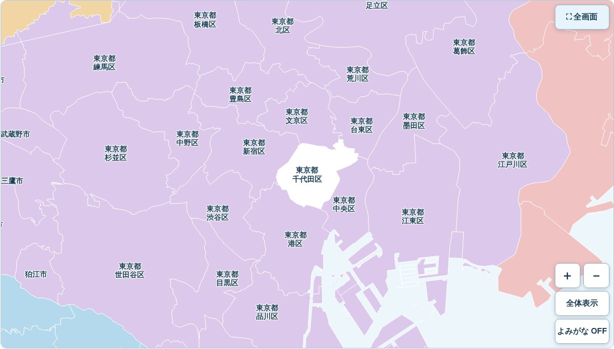
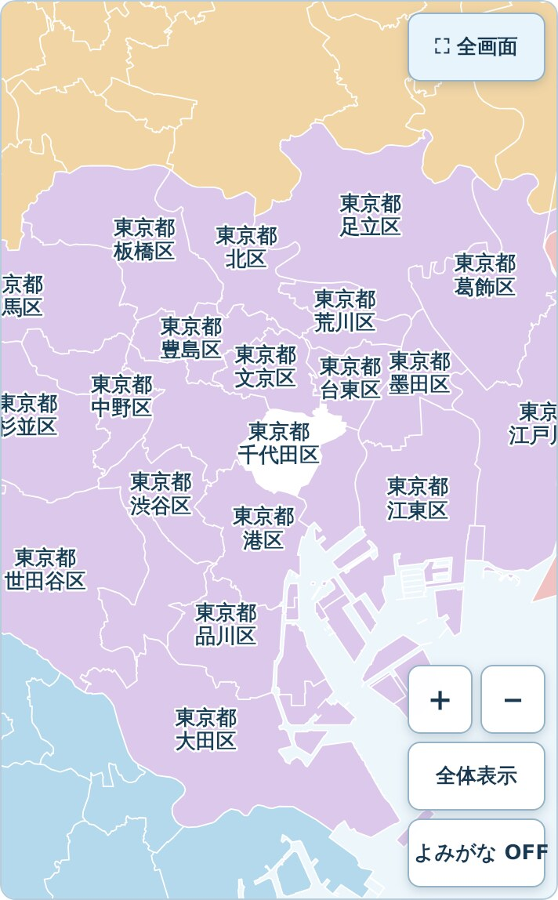
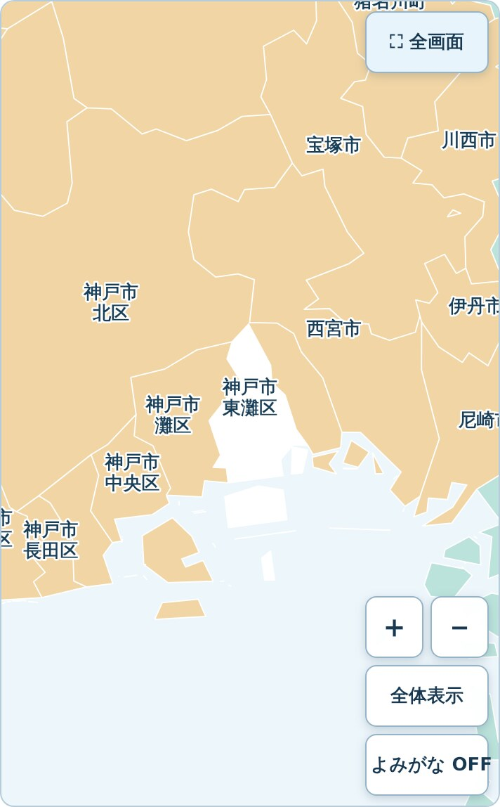

# PR #344 表示確認用スクリーンショット

Draft PRブランチの全国共通 `?studyPref` 表示から取得したブラウザー画像です。公開mainには含まれていません。

## 東京23区（千代田区へ検索フォーカス）

Chromiumデスクトップ:

WebKit 390×844相当:

## 兵庫県（神戸市東灘区へ検索フォーカス）

WebKit 390×844相当:

全5地域の表示数・重なり数・viewBox計測はPR #344にリンクしたGitHub ActionsのJSONレポートを参照してください。WebKitはiPhone相当幅の自動試験であり、実機Safariではありません。